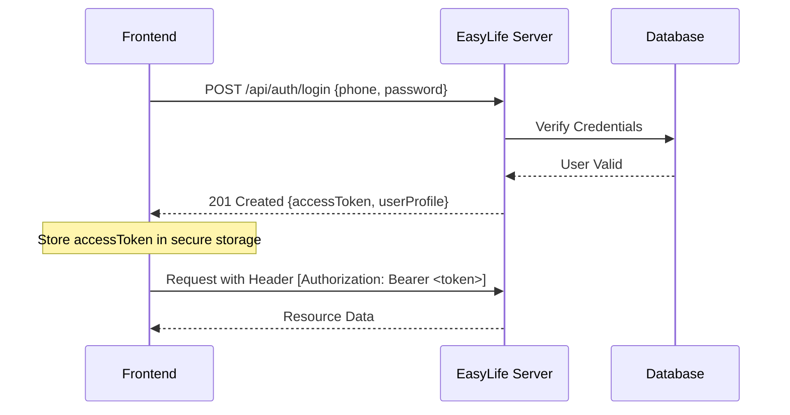

# API Documentation - EasyLife Server v2

## Overview

**EasyLife Server v2** is a Multi-Tenant ERP API designed to manage business operations including user management, product catalogs, supplier relations, purchasing, production, customer orders, and expense tracking.

### Base URL & Configuration

- **Base URL:** `http://localhost:8080` (Development)
- **Environment:** Ensure the `x-tenant-id` header is present in every request to route the request to the correct tenant database.

---

## 🔐 Authentication & Security

### Authentication Flow

The API uses JWT (JSON Web Tokens) for authentication.



### Security Requirements

1. **Tenant Identification**: Every request must include the `x-tenant-id` header.
2. **Bearer Token**: Protected endpoints require the `Authorization: Bearer <token>` header.

---

## 📦 API Modules

### 1. Auth & Profile

Manage user sessions and profile information.

| Method | Endpoint                | Purpose                         | Auth   |
| :----- | :---------------------- | :------------------------------ | :----- |
| `POST` | `/api/auth/login`       | Authenticate user and get token | Public |
| `POST` | `/api/auth/logout`      | Invalidate current session      | Token  |
| `GET`  | `/api/auth/get-profile` | Retrieve current user profile   | Token  |

#### `/api/auth/login`

- **Request Body**:
  - `phone` (string, required): User's phone number.
  - `password` (string, required): User's password.
- **Example Request**:
  ```bash
  curl -X POST http://localhost:8080/api/auth/login \
  -H "Content-Type: application/json" \
  -d '{"phone": "01853860483", "password": "Iqbal0483"}'
  ```
- **Success Response (201)**: Returns JWT and user data.

---

### 2. User Management

Administrative control over users and their roles.

| Method   | Endpoint                     | Purpose                    | Auth  |
| :------- | :--------------------------- | :------------------------- | :---- |
| `POST`   | `/api/user/create`           | Create a new user          | Admin |
| `GET`    | `/api/user/all`              | List all users (Paginated) | Admin |
| `GET`    | `/api/user/single-user/{id}` | Get specific user details  | Admin |
| `PUT`    | `/api/user/update/{id}`      | Update user information    | Admin |
| `DELETE` | `/api/user/delete/{id}`      | Remove a user              | Admin |

#### `/api/user/create`

- **Request Body** (`multipart/form-data`):
  - `name` (string, required)
  - `address` (string, required)
  - `phone` (string, required)
  - `password` (string, required)
  - `designation` (enum: `super_admin`, `admin`, `store_manager`, `sales_man`, required)
  - `profile` (file/string, optional)
- **Example Request**:
  ```bash
  curl -X POST http://localhost:8080/api/user/create \
  -F "name=John Doe" -F "address=Dhaka" -F "phone=01987654321" \
  -F "password=pass123" -F "designation=sales_man" -F "profile=@path/to/img.jpg"
  ```

---

### 3. Commission & Targets

Define and track sales targets and calculate commissions.

| Method   | Endpoint                                   | Purpose                     | Auth  |
| :------- | :----------------------------------------- | :-------------------------- | :---- |
| `POST`   | `/api/user/target/create`                  | Set target for a user       | Admin |
| `PUT`    | `/api/user/target/update/{id}`             | Modify existing target      | Admin |
| `GET`    | `/api/user/target/all`                     | List all targets (Filtered) | Admin |
| `GET`    | `/api/user/target/single/{id}`             | Get target details          | Admin |
| `DELETE` | `/api/user/target/delete/{id}`             | Remove a target             | Admin |
| `GET`    | `/api/user/target/commission/pending`      | List pending commissions    | Admin |
| `POST`   | `/api/user/target/commission/approve/{id}` | Approve a commission        | Admin |
| `DELETE` | `/api/user/target/commission/reject/{id}`  | Reject a commission         | Admin |

#### `/api/user/target/all`

- **Query Parameters**:
  - `userId` (number, optional)
  - `status` (enum: `pending`, `running`, `achived`, `failed`, optional)
  - `page` (number, optional)
  - `limit` (number, optional)

---

### 4. Product Catalog

Manage products, pricing, and inventory.

| Method   | Endpoint                    | Purpose                  | Auth  |
| :------- | :-------------------------- | :----------------------- | :---- |
| `POST`   | `/api/product/create`       | Add new product          | Admin |
| `GET`    | `/api/product/all`          | List products (Filtered) | Token |
| `GET`    | `/api/product/single/{id}`  | Get product details      | Token |
| `PUT`    | `/api/product/update/{id}`  | Update product           | Admin |
| `DELETE` | `/api/product/delete/{id}`  | Soft delete product      | Admin |
| `PUT`    | `/api/product/restore/{id}` | Restore from trash       | Admin |
| `GET`    | `/api/product/trash`        | List deleted products    | Admin |

#### `/api/product/create`

- **Request Body** (`multipart/form-data`):
  - `name` (string, required)
  - `short_name` (string, optional)
  - `type` (string, optional)
  - `price` (number, required)
  - `cost` (number, required)
  - `sl` (number, optional)
  - `init_stock` (number, optional)

---

### 5. Supplier & Purchasing

Manage vendors and procurement.

| Method   | Endpoint                    | Purpose                   | Auth  |
| :------- | :-------------------------- | :------------------------ | :---- |
| `POST`   | `/api/supplier/create`      | Add new supplier          | Admin |
| `GET`    | `/api/supplier/all`         | List suppliers            | Admin |
| `GET`    | `/api/supplier/single/{id}` | Get supplier details      | Admin |
| `PUT`    | `/api/supplier/update/{id}` | Update supplier           | Admin |
| `DELETE` | `/api/supplier/delete/{id}` | Remove supplier           | Admin |
| `POST`   | `/api/purchase/create`      | Create purchase order     | Admin |
| `GET`    | `/api/purchase/all`         | List purchases (Filtered) | Admin |
| `GET`    | `/api/purchase/single/{id}` | Get purchase details      | Admin |
| `PUT`    | `/api/purchase/pay/{id}`    | Record supplier payment   | Admin |

#### `/api/purchase/create`

- **Request Body** (`multipart/form-data`):
  - `supplier_id` (number, required)
  - `products` (array of `PurchaseProductItemDto`, required)
  - `total_amount` (number, required)
  - `payment` (number, optional)
  - `discount` (number, optional)
  - `payment_info` (string, optional)

---

### 6. Production

Manage the conversion of components into finished products.

| Method | Endpoint                 | Purpose                  | Auth  |
| :----- | :----------------------- | :----------------------- | :---- |
| `POST` | `/api/production/create` | Create production record | Admin |
| `GET`  | `/api/production/all`    | List production records  | Admin |

---

### 7. Customer & Orders

Sales management from lead to delivery.

| Method   | Endpoint                          | Purpose                     | Auth  |
| :------- | :-------------------------------- | :-------------------------- | :---- |
| `POST`   | `/api/customer/create`            | Add new customer/shop       | Admin |
| `GET`    | `/api/customer/all`               | List customers              | Admin |
| `GET`    | `/api/customer/single/{id}`       | Get customer details        | Admin |
| `PUT`    | `/api/customer/update/{id}`       | Update customer             | Admin |
| `DELETE` | `/api/customer/delete/{id}`       | Remove customer             | Admin |
| `POST`   | `/api/order/create`               | Create new order            | Token |
| `GET`    | `/api/order/all`                  | List orders (Filtered)      | Token |
| `GET`    | `/api/order/single/{id}`          | Get order details           | Token |
| `PUT`    | `/api/order/update/{id}`          | Update order                | Admin |
| `PUT`    | `/api/order/deliver/{id}`         | Mark as delivered           | Token |
| `PUT`    | `/api/order/collect/{id}`         | Record payment collection   | Token |
| `DELETE` | `/api/order/delete/{id}`          | Remove order                | Admin |
| `PUT`    | `/api/order/approve-pending/{id}` | Approve pending order       | Admin |
| `GET`    | `/api/order/my-collections`       | Get orders for current user | Token |

#### `/api/order/create`

- **Request Body**:
  - `shop_id` (number, required)
  - `products` (array of `OrderProductItemDto`, required)
  - `total_sale` (number, required)
  - `payment` (number, optional)

---

### 8. Expenses

Track business expenditures.

| Method | Endpoint                                  | Purpose                  | Auth  |
| :----- | :---------------------------------------- | :----------------------- | :---- |
| `POST` | `/api/expense/create`                     | Submit new expense       | Token |
| `GET`  | `/api/expense/single/{id}`                | Get expense details      | Token |
| `GET`  | `/api/expense/get-all-expense-categories` | List categories          | Token |
| `GET`  | `/api/expense/get-all-expenses`           | List expenses (Filtered) | Token |
| `POST` | `/api/expense/approve/{id}`               | Approve expense          | Admin |
| `PUT`  | `/api/expense/reject/{id}`                | Reject expense           | Admin |

---

### 9. Notes & Internal Communications

User-specific notes and system-wide notifications.

| Method   | Endpoint                     | Purpose                          | Auth  |
| :------- | :--------------------------- | :------------------------------- | :---- |
| `POST`   | `/api/user/note/create`      | Create a note                    | Token |
| `GET`    | `/api/user/note/all`         | List user notes                  | Token |
| `GET`    | `/api/user/note/single/{id}` | Get note details                 | Token |
| `PUT`    | `/api/user/note/update/{id}` | Update note                      | Token |
| `DELETE` | `/api/user/note/delete/{id}` | Delete note                      | Token |
| `POST`   | `/api/notification/send`     | Send notification to users/roles | Admin |

---

### 10. Dashboard & Reporting

Analytics and financial reports.

| Method | Endpoint                       | Purpose                         | Auth  |
| :----- | :----------------------------- | :------------------------------ | :---- |
| `GET`  | `/api/dashboard`               | General dashboard summary       | Token |
| `GET`  | `/api/dashboard/cash-report`   | Cash flow report                | Token |
| `GET`  | `/api/dashboard/notifications` | Get undelivered orders alert    | Token |
| `GET`  | `/api/dashboard/chart`         | Time-series chart data          | Token |
| `GET`  | `/api/dashboard/piechart`      | Distribution pie chart data     | Token |
| `GET`  | `/api/dashboard/product-chart` | Product performance data        | Token |
| `GET`  | `/api/dashboard/stock-report`  | Inventory status report         | Token |
| `GET`  | `/api/dashboard/user-sales`    | Specific user sales performance | Admin |
| `GET`  | `/api/dashboard/transactions`  | Transaction history report      | Token |

---

### 11. Transactions & Balance Transfer

Internal fund movements between users.

| Method   | Endpoint                             | Purpose                  | Auth  |
| :------- | :----------------------------------- | :----------------------- | :---- |
| `POST`   | `/api/user/transaction/transfer`     | Initiate transfer        | Token |
| `POST`   | `/api/user/transaction/receive/{id}` | Accept a transfer        | Token |
| `DELETE` | `/api/user/transaction/decline/{id}` | Decline a transfer       | Token |
| `GET`    | `/api/user/transaction/pending`      | List pending transfers   | Token |
| `GET`    | `/api/user/transaction/history`      | User transaction history | Token |

---

### 12. Tenant Administration

Global settings for the multi-tenant instance.

| Method | Endpoint                   | Purpose                | Auth  |
| :----- | :------------------------- | :--------------------- | :---- |
| `GET`  | `/api/admin/tenant/info`   | Get tenant information | Admin |
| `PUT`  | `/api/admin/tenant/update` | Update tenant settings | Admin |

---

## 🛠 Integration Guides

### Common Error Handling

The API uses standard HTTP status codes:

- `200 OK`: Success.
- `201 Created`: Resource successfully created.
- `400 Bad Request`: Validation error or malformed request.
- `401 Unauthorized`: Missing or invalid token.
- `403 Forbidden`: Insufficient permissions for the role.
- `404 Not Found`: Resource not found.
- `500 Internal Server Error`: Server-side failure.

### Pagination & Filtering

Most `GET /all` endpoints support:

- `page`: Current page number.
- `limit`: Items per page.
- `search`: Keyword search across primary fields.

### File Uploads

Endpoints using `multipart/form-data` (e.g., `/api/user/create`, `/api/product/create`) expect files to be sent as binary parts. Ensure the `Content-Type` is set correctly by the browser/client.

### Request Sequence Example: Creating an Order

1. `GET /api/customer/all` $\rightarrow$ Find `shop_id`.
2. `GET /api/product/all` $\rightarrow$ Find `product_id`s and current prices.
3. `POST /api/order/create` $\rightarrow$ Submit order with `shop_id` and `products` array.
4. `PUT /api/order/deliver/{id}` $\rightarrow$ Once the order is out for delivery and received.
